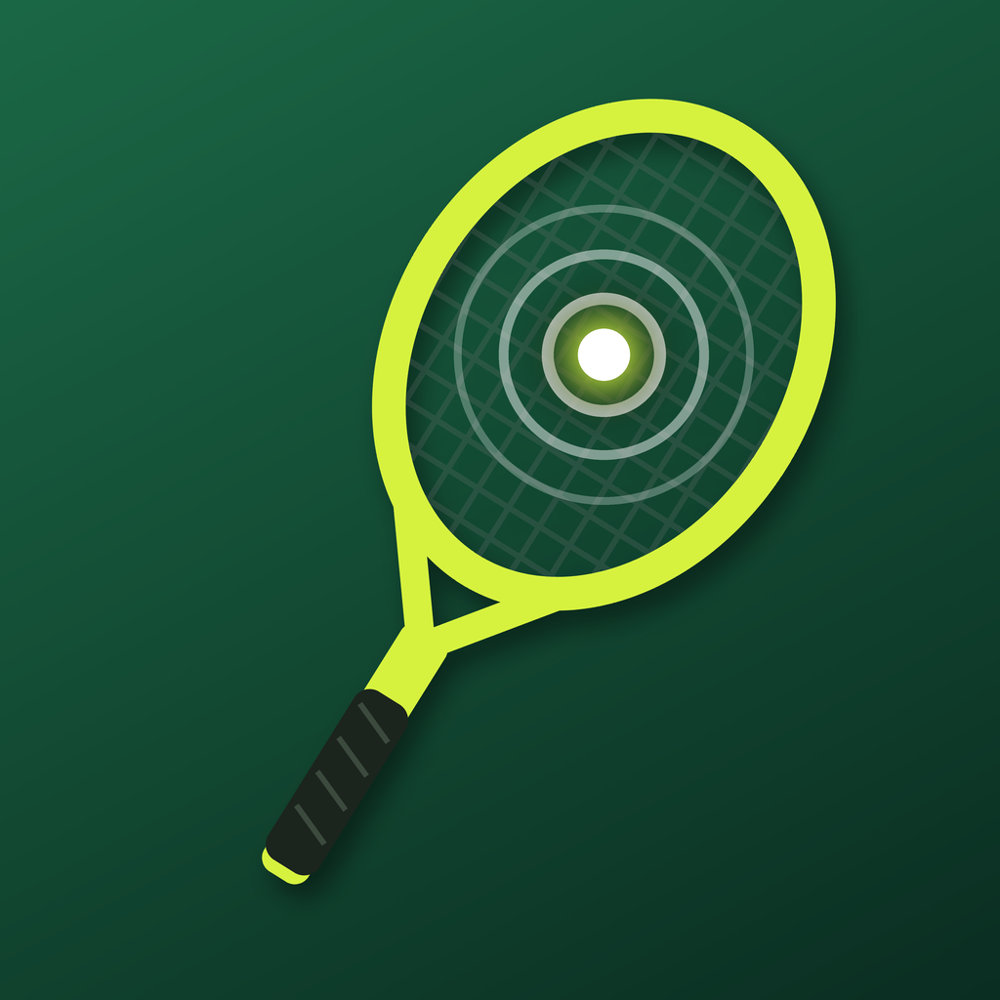

# 🎾 Tennis Buddy

A tennis racket that knows every shot you hit. Sensors hidden in the handle of a Yonex VCore 98 measure swing speed,
ball speed, spin, face angle and where the ball hit the strings. iPhone, Mac and Apple Watch apps turn it into
analytics, and an on-device **Llama 3.2 3B** model coaches you in plain language, fully offline.

**Try it:** [TestFlight public beta](https://testflight.apple.com/join/137F7kvd) (iPhone + Apple Watch; runs in
Simulator mode without the racket).

## Repository layout

| Folder | Contents |
|---|---|
| [`firmware/`](firmware/) | PlatformIO project for the Seeed XIAO ESP32C3 (MPU6050 + H3LIS331DL, BLE streaming) |
| [`ml/`](ml/) | **Open-source on-device model**: sweet spot or not, and % off, from the impact sound (trainer, docs) |
| [`apple/`](apple/) | Xcode project: iPhone + Mac app, Watch app, shared `RacketKit` Swift package |
| [`TennisRobot/`](TennisRobot/) | Epson arm pipeline: simulation projects, SPEL+ programs, bring-up and calibration docs |
| [`backend/`](backend/) | Supabase schema and edge functions |
| [`website/`](website/) | Project site |
| [`tools/`](tools/) | Python analysis scripts |
| [`data/`](data/) | Calibration recordings |
| [`docs/`](docs/) | [Plan](docs/PLAN.md), calibration guide, demo script |

## Hardware

Seeed XIAO ESP32C3 · MPU6050 (±2000 °/s gyro) · Adafruit H3LIS331DL (±200 g) · INMP441 mic · 1S LiPo, all in a
3D-printed insert that replaces the handle's foam core. The textured 3D racket in the apps is a custom model,
exported to `apple/Shared/Resources/TennisRacket.glb`. Pin map and BLE protocol: [docs/PLAN.md](docs/PLAN.md).

## License

MIT.
