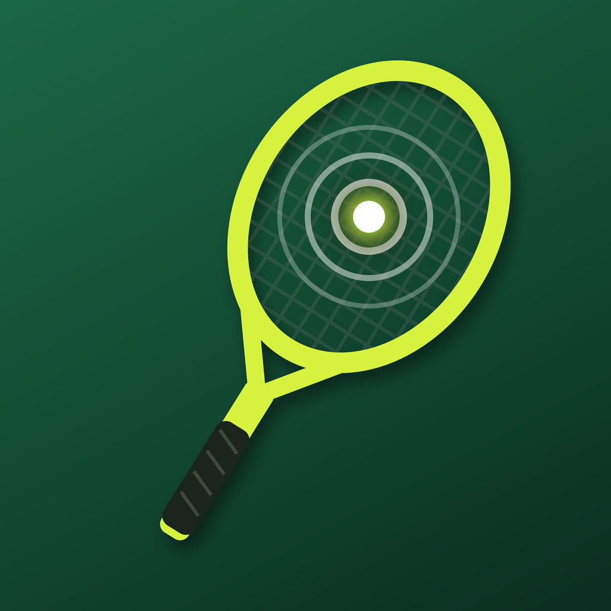

# 🎾 Tennis Buddee

**A smart tennis racket that feels every shot.** A sensor insert hidden in the handle measures each hit: swing speed,
ball speed, spin, face angle, stroke type and where the ball met the strings. The racket computes the shot itself
and sends it to an iPhone, Mac, Apple Watch and **Meta Ray-Ban Display** glasses. **Meta Muse Spark** works as an
agent over the player's own shots and the live racket: it runs a physics simulator to predict what a swing change
would do, then plans a drill that the Watch and glasses track.

- **Try the live app in your browser:** [Open the Tennis Buddee emulator](https://tennisbuddy.net/emulator) — no hardware or installation needed.
- **Website:** [tennisbuddy.net](https://tennisbuddy.net)
- **Built for:** the Meta Global AI Developer Hackathon. Started during the hackathon and updated afterwards.

| Rubric | Where to look |
|---|---|
| Impact (30%) | [Impact](#impact) |
| Use of Meta AI tooling (25%) | [Use of Meta AI tooling](#use-of-meta-ai-tooling): Muse Spark agent with 10 tools, Ray-Ban Display HUD, a 2,263-conversation tool-use dataset |
| Technical depth and execution (20%) | [Technical depth and execution](#technical-depth-and-execution): firmware, apps, ML, tests |
| Demo (25%) | [Demo](#demo) |

Judging? Start with [`JUDGING.md`](JUDGING.md): a map from each rubric item to the exact files and
commands that prove it. Machines: [`llms.txt`](llms.txt) and [`hackathon.json`](hackathon.json).

## Impact

**The problem.** A club player hits hundreds of shots a night and can't tell which ones were good. Lessons are
expensive and come once a week. Clip-on sensors change the racket's feel and give a few numbers with no next step.
Video needs someone to film and someone to watch it.

**Who benefits.** Recreational and club players, high-school and college players, and anyone learning the game
without a pro next to them. Tennis is a sport of millions of regular players, and almost none of them have data on
their own strokes.

**What changes for them.**

- Every hit is measured inside the player's own racket, with no clip-on and no change in feel.
- They get an answer they can act on at once: "move contact 1 cm toward the center: ball speed goes from 150 to about 151 km/h, spin holds".
  It comes from their own shots, run through a simulator. It is not generic advice.
- The answer turns into a drill that the Watch counts and the glasses show, mid-session.
- Scoring by double-tapping the handle, and sessions shared with friends ("Play together"), make it part of
  every match, not just practice.

**Could it become a product?** It already works like one:

- an 86-minute real club session that changed the design ([`docs/CLUB_2026-10-28.md`](docs/CLUB_2026-10-28.md));
- accounts with Sign in with Apple and Google;
- iCloud sync and over-the-air firmware updates.

The insert uses off-the-shelf parts (ESP32-C3, LSM6DSV320X, INMP441, 1S LiPo) in a 3D-printed core that replaces the
handle's foam, so the same design fits other rackets. Next: more labeled sessions, a "close to the sweet spot"
state, and a robot-arm rig for repeatable ground truth ([`TennisRobot/`](TennisRobot/)).

## Use of Meta AI tooling

| Meta technology | What it does here | Code |
|---|---|---|
| **Open Muse Spark** (`meta-models/muse-spark-open-1026` on Baseten, native function calling) | An agent with 10 tools over the player's data and the live racket | [`apple/Shared/Coach/`](apple/Shared/Coach/), [`CoachTools.swift`](apple/Shared/Coach/CoachTools.swift) |
| **Muse Spark through a server proxy** | A Supabase edge function holds the Meta API key; the app never ships one | [`backend/supabase/functions/muse/`](backend/supabase/functions/muse/index.ts) |
| **Muse Spark directs the swing film** | Muse tests swing changes with `simulate_change` and returns a short, validated script; the What-if screen animates the player's swing and the change in 3D | [`SwingFilm.swift`](apple/Shared/Coach/SwingFilm.swift), [`SwingAnimationView.swift`](apple/Shared/Views/SwingAnimationView.swift), [`docs/SWING_FILM.md`](docs/SWING_FILM.md) |
| **Meta Wearables Device Access Toolkit** (`MWDATCore`, `MWDATDisplay`) | Live HUD on **Meta Ray-Ban Display**: latest shot, sweet-spot rate, score, drill progress | [`apple/iOS/Glasses/`](apple/iOS/Glasses/) |
| **Tool-use dataset for Muse** | 2,263 synthetic conversations whose tool results match the app exactly, for evals and tuning | [`ml/whatif_synth.py`](ml/whatif_synth.py), [`docs/WHATIF_DATASET.md`](docs/WHATIF_DATASET.md) |
| **Meta SAM 3.1 video + image APIs** | Labels the ground truth: racket tracks and ball/racket-head pre-fill behind the reviewed contacts; tracks convert to emulator sessions (9 matches, 2,265 hits; stroke types are F3Tennis dataset labels for the Ostrava final and F3Tennis model predictions, flagged as predicted, for the other 8) | [`tools/sam_f3set_video.py`](tools/sam_f3set_video.py), [`ml/stroke_system/sam_contacts.py`](ml/stroke_system/sam_contacts.py), [`tools/sam_track_to_session.py`](tools/sam_track_to_session.py) |

**Beyond a basic integration.**

1. **Muse runs experiments, not just summaries.** `simulate_change` applies a swing change (speed, face angle,
   path, contact point) to the player's own average stroke. It returns the predicted ball speed and spin, and Muse
   must label the result an estimate. The dataset teaches it to pick the smallest change that reaches the goal.
2. **Muse can read a physical device.** `read_live_sensors` returns the last 0.2–5 s of rotation rate, high-g and
   tilt. `get_racket_status` returns firmware, battery and sensor health. The model asks the racket what is
   happening right now.
3. **Long-term memory with guardrails.** `recall_notes` and `remember_note` keep habits, goals and injuries across
   sessions. Muse can save at most 2 notes per answer, 240 characters each. Notes it adds are tagged in the UI. Notes
   are passed as data, never as instructions.
4. **Muse's output reaches the wrist and the lens.** A drill Muse plans goes to Apple Watch, which counts it down,
   and to Ray-Ban Display.
5. **Grounded numbers.** The prompt allows only numbers that came from tools. The dataset tests check that every
   number in an answer appears in a tool result.
6. **Production limits.** At most 5 requests and 8 tool calls per round. 45 s timeout. HTTP 429 falls back at once
   to a built-in engine, and the UI names the engine that answered.
7. **Meta models label the training data.** SAM 3.1 tracks rackets through video and pre-fills contact
   labels (a human confirms every one); the cached observations feed the stroke-system baseline
   ([`ml/stroke_system/`](ml/stroke_system/)) and the web emulator ([live emulator](https://tennisbuddy.net/emulator)).

The 10 tools: `query_shots`, `compare_sessions`, `get_session_digest`, `get_live_state`, `simulate_change`,
`list_shots`, `read_live_sensors`, `get_racket_status`, `recall_notes`, `remember_note`.

**A tool-call trace** from the generated dataset. The tool results come from the same physics the app runs:

```text
player   I keep mishitting my backhand. What should I fix?
muse  →  get_session_digest()
tool  ←  { backhand contact 2.0 cm toward the tip, ... }
muse  →  simulate_change(type: "backhand", contact_x_cm: 0.0, contact_y_cm: -1.0)
tool  ←  { before: ball_speed 149.6 km/h, spin 1,066 rpm · after: ball_speed 151.3 km/h, spin 1,066 rpm }
muse     Your backhand contact sits 2.0 cm toward the tip. Try this: move contact 1.0 cm back toward the center
         of the strings. The estimate says ball speed goes from 150 km/h to about 151 km/h and spin holds at
         1,070 rpm. Cue: step in so you are not reaching for the ball. These are physics estimates on your
         average shot, not measured results.
```

## Technical depth and execution

```
┌──────────── Racket handle ────────────┐        BLE          ┌──────── iPhone / Mac app (SwiftUI) ────────┐
│ LSM6DSV320X: gyro ±4000 dps,          │  hit → shot summary │ RacketKit: decode, orientation, analysis   │
│   accel ±16 g and ±320 g, 1 kHz       │  → 448 ms window    │ SwiftData + iCloud sync                    │
│ INMP441 mic → sweet-spot model        │  (acked, resent,    │ Muse Spark agent ──► Supabase edge fn ──► Meta API
│ ESP32-C3: impact detect, shot physics,│   flash backlog)    │ What-if simulator (ShotSimulator)          │
│   tap scoring, OTA update             │ ──────────────────► │                                            │
└───────────────────────────────────────┘                     └───────┬──────────────────────┬─────────────┘
                                                                      │ WatchConnectivity    │ Meta Wearables DAT
                                                               Apple Watch: haptics,   Meta Ray-Ban Display:
                                                               workout, drills, score  live HUD
```

**Decisions driven by real data.**

- *Raw streaming failed on court.* At the club, only about 17% of the 1 kHz stream arrived. So firmware 1.6 computes
  each shot on the racket. [`firmware/src/shot.cpp`](firmware/src/shot.cpp) is a C++ port of the app's Swift
  `ShotAnalyzer`. The racket sends an 80-byte summary first, then the raw 448-sample window with acks and resends.
  With no phone nearby, windows go to flash (up to 117) and are sent later, even after a reboot.
- *The gyro clipped at ±2000 dps.* The club data showed it. The cause was a range change written while the gyro was
  running. Firmware 1.6 changes the range ST's way and checks the readback.
- *Sweet spot from sound.* A ridge model on 156 audio features runs on the ESP32-C3. Its C++ and Python versions
  agree on all 296 test clips.

**Evidence.**

| Check | Result | Source |
|---|---|---|
| Swift tests | 106 test methods (62 RacketKit + 44 app): C++ ↔ Swift shot parity, labeled real sessions, replay, scoring, simulator, Muse agent with mocked HTTP, scout/plan/review prompts and parsers | [`apple/RacketKit/Tests/`](apple/RacketKit/Tests/), [`apple/Tests/`](apple/Tests/) |
| Python tests | 150 cases: ML and what-if tools (99 unittest), robot pipeline (51 pytest); 2 pre-existing unittest collection errors (installed scipy dropped `sph_harm`, `serial` module missing) | `ml/test_*.py`, `tools/test_*.py`, `TennisRobot/tests/` |
| What-if agent answers (Baseten spark-open) | 87.7% strict all-pass on 243 val cases: digest-first, grounded numbers, estimate labels, target reached (45 tail cases lost to a proxy outage, excluded per scorer convention) | [`tools/agent_eval.py`](tools/agent_eval.py), [`docs/WHATIF_DATASET.md`](docs/WHATIF_DATASET.md) |
| Backend tests | Migration + social logic in embedded PGlite (`npm test`) | [`backend/supabase/tests/`](backend/supabase/tests/) |
| Firmware host test | Flash backlog against a fake flash, under ASan/UBSan | [`firmware/tools/backlog_test`](firmware/tools/backlog_test) |
| Firmware ↔ Python ML parity | Same decision on 296 clips; max distance error 7e-7 cm | `ml/test_parity.py` |
| Sweet-spot model, real hits | 67.2% accuracy (baseline 60.6%), 1.83 cm mean distance error, 274 labeled clips, grouped 5-fold | [`ml/runs/SUMMARY-20261028.md`](ml/runs/SUMMARY-20261028.md) |

We report weak results too. The sweet-spot model only modestly beats the baseline. The run summary explains why
(label scale differs between sessions) and lists the next steps.

## Demo

- **Demo video:** [Watch Tennis Buddee in action](https://youtu.be/B_Mw23IpRUQ) · [video source](video/).
- **Try in your browser:** [Open the live emulator](https://tennisbuddy.net/emulator).
- **Holds up live:**
  - The racket keeps every hit when Bluetooth drops: it acks, resends and keeps a flash backlog.
  - Any recorded session replays exactly like the live racket.
  - If the network or Muse fails, the built-in engine answers and the UI says so.

## Run it

```bash
# Apps: open in Xcode and run TennisBuddy-iOS or TennisBuddy-macOS (no racket needed: Simulator source)
open apple/TennisBuddy.xcodeproj

# Tests
swift test --package-path apple/RacketKit
pip install numpy scipy && python3 ml/test_parity.py
python3 -m unittest discover -s ml -p test_whatif_synth.py

# Firmware (Seeed XIAO ESP32C3)
cd firmware && pio run -t upload && pio device monitor
```

Details: [`apple/README.md`](apple/README.md), [`firmware/README.md`](firmware/README.md),
[`docs/WIRING.md`](docs/WIRING.md), [`backend/supabase/README.md`](backend/supabase/README.md).

## Repository map

| Folder | Contents |
|---|---|
| [`apple/`](apple/) | Xcode project: iPhone + Mac app, Watch app, Ray-Ban Display HUD, Muse Spark agent, shared `RacketKit` Swift package |
| [`firmware/`](firmware/) | PlatformIO firmware for the XIAO ESP32C3: impact detection, on-racket shot analysis, tap scoring, mic model, BLE protocol, OTA |
| [`ml/`](ml/) | Sweet-spot audio model (trainer, firmware export, parity tests), Muse what-if dataset generator, model run reports |
| [`backend/`](backend/) | Supabase schema (accounts, friends, shared sessions) and the `muse` edge function |
| [`tools/`](tools/) | Python scripts for recording, labeling and checking sessions |
| [`data/`](data/) | Small calibration and tap recordings (large raw sessions stay local) |
| [`TennisRobot/`](TennisRobot/), [`robot/`](robot/) | Camera + Epson C8 arm rig to swing the racket repeatably for ground truth (framework, simulated) |
| [`video/`](video/) | Remotion source for the 3-minute demo video |
| [`baseten/`](baseten/) | Truss config to self-host Meta's open Muse Glimmer 30B (experiment) |
| [`docs/`](docs/) | Wiring, data collection, club session report, privacy, TestFlight, original build plan |
| [`JUDGING.md`](JUDGING.md), [`llms.txt`](llms.txt), [`hackathon.json`](hackathon.json) | Judging evidence map, LLM index, machine-readable metadata |

## Privacy

Shot data stays on the player's devices and private iCloud. Shared scores and summaries go to our Supabase backend
only when the player shares them. Only what Muse fetches for an answer goes to Baseten, which hosts Meta's open Muse Spark, through our proxy. See
[`docs/PRIVACY.md`](docs/PRIVACY.md).

## License

MIT. See [`LICENSE`](LICENSE). Started from the idea in
[AahanPrajapati/Smart-Tennis-Racket](https://github.com/AahanPrajapati/Smart-Tennis-Racket) (MIT).
